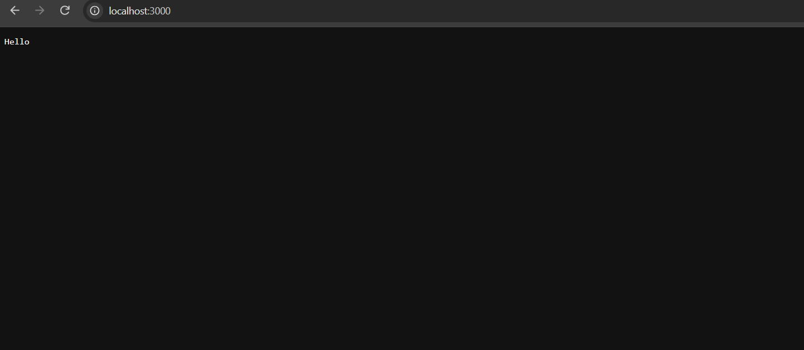
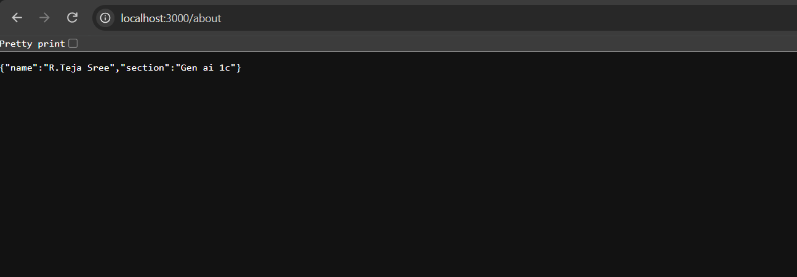
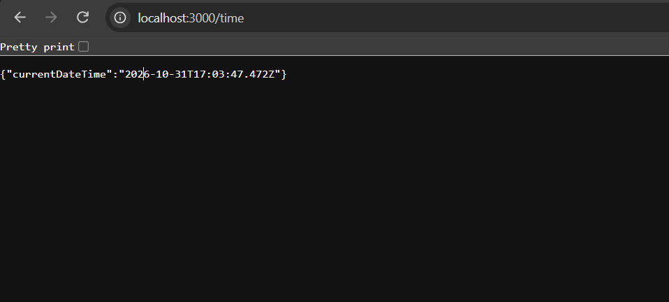

# Backend Development Fundamentals — Lab 1

## Student Details

- **Name:** R.TEJA SREE
- **Registration Number:** 252U1R9139
- **Section:** CSE GEN AI 1-C

## About the Project

This project is part of my Backend Development Fundamentals lab. It demonstrates how to create a basic HTTP server using Node.js and build a web server using Express.js.

## Technologies Used

- Node.js
- Express.js
- JavaScript

## Features

- **Home Route (`/`)** — Displays a welcome message.
- **About Route (`/about`)** — Displays my name and section.
- **Time Route (`/time`)** — Displays the current server time.
- **Unknown Routes** — Returns a 404 Not Found response.

## Project Structure

```text
lab-01/
├── http-server.js
├── server.js
├── package.json
├── package-lock.json
├── .gitignore
├── README.md
└── screenshots/
    ├── about.png
    ├── hello.png
    ├── time.png
    └── unknown route.png
```

## How to Run the Project

### 1. Install Dependencies

Open the terminal inside the `lab-01` folder and run:

```bash
npm install
```

### 2. Start the Express Server

```bash
node server.js
```

### 3. Open in Your Browser

Visit the following URLs:

- [Home Route](http://localhost:3000/)
- [About Route](http://localhost:3000/about)
- [Time Route](http://localhost:3000/time)

To stop the server, press `Ctrl + C` in the terminal.

## Screenshots

### 1. Home Route



### 2. About Route



### 3. Time Route



### 4. Unknown Route


## Conclusion

This lab helped me understand how to create a basic HTTP server using Node.js and implement different routes using Express.js. I also learned how to handle unknown routes and return appropriate 404 responses.