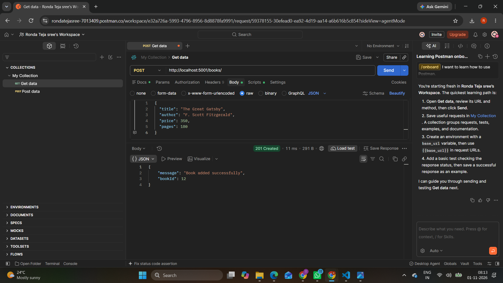
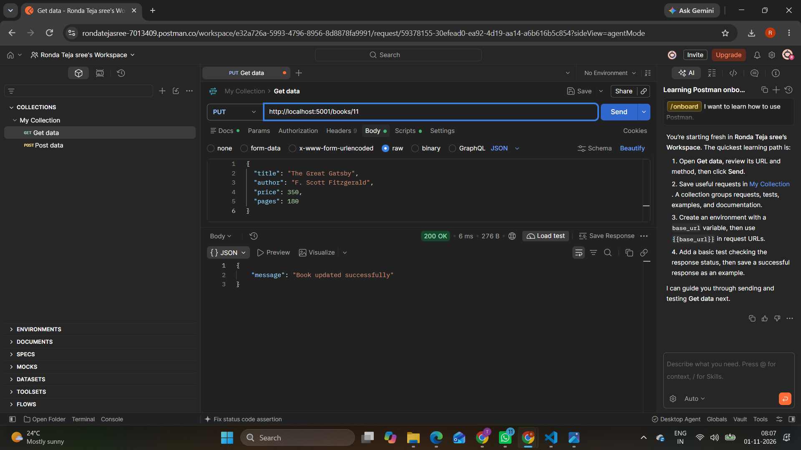
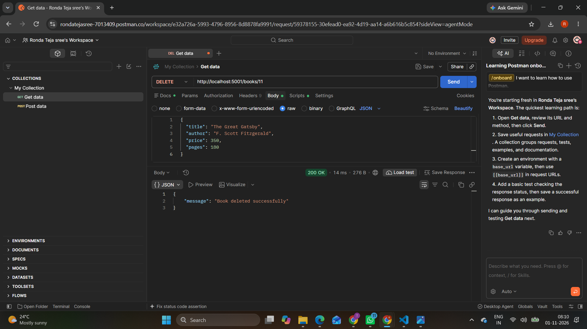

# Lab 2: SQLite Database and CRUD Routes

## Student Details

- **Name:** [R.Teja Sree]
- **Registration Number:** [252U1R9139]
- **Section:** [CSE GEN AI 1-C]

## Objective

To connect an Express.js server with an SQLite database and implement CRUD (Create, Read, Update, Delete) operations through REST API endpoints.

## Technologies Used

- Node.js
- Express.js
- SQLite
- JavaScript
- Postman

## Project Description

This project uses an SQLite database to store book information. An Express.js server provides REST API endpoints to perform CRUD operations on the books table.

Each book contains the following details:

- Book ID
- Title
- Author
- Price
- Pages

## Project Setup

### 1. Install dependencies

Open the terminal inside the `lab-02` folder and run:

```bash
npm install
```

### 2. Start the server

```bash
npm run dev
```

The server runs at:

`http://localhost:5001`

## API Endpoints

| Method | Endpoint | Description |
|---|---|---|
| GET | `/books/` | Get all books |
| GET | `/books/:bookId/` | Get a book by ID |
| POST | `/books/` | Add a new book |
| PUT | `/books/:bookId/` | Update book details |
| DELETE | `/books/:bookId/` | Delete a book |

## Database

The project uses SQLite with a database file named `books.db`.

The `book` table contains:

- `id` – INTEGER PRIMARY KEY
- `title` – TEXT
- `author` – TEXT
- `price` – INTEGER
- `pages` – INTEGER

The database contains sample book records for testing the API operations.

## Postman Screenshots

### 1. Get All Books


### 2. Get a Single Book


### 3. Add a New Book



### 4. Update a Book



### 5. Delete a Book



## Conclusion

This lab demonstrates how to connect an Express.js application with an SQLite database and perform CRUD operations using REST API endpoints. All five endpoints were tested using Postman.